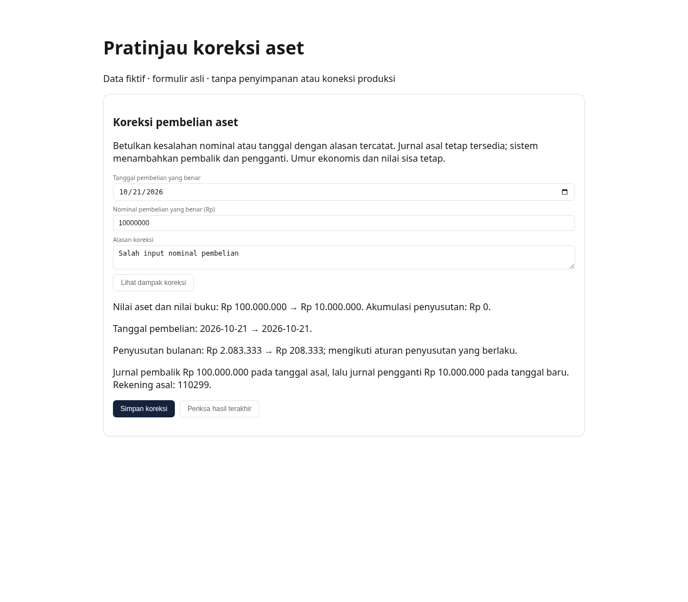

# Asset purchase corrections — review and release gates

Base: `d6d9c70d24fed05ff16a2dfd32f55cbeaa48fb3f` (`main`, rechecked 21 October 2026).
Branch: `codex/kamo-asset-correction`.

## Actual gap and delivered behavior

Reviewed repository `AGENTS.md`, `CLAUDE.md`, the PostgreSQL engineering references,
current main, PR #62 and the open PR list (#10/#11/#18/#23/#62). Existing acquisition
posting and request recovery already handle new cash/bank purchases atomically;
they are reused, not replaced. PR #62 has a depreciation reset-cutoff change but
no acquisition-correction implementation. This branch does not change that engine.

An active OWNER (the existing Super Admin role) can correct the nominal amount or
date of a proven cash/bank acquisition **in the current WIB month, before any
depreciation or downstream history**. Preview shows old/new acquisition value,
book value, dates, monthly straight-line depreciation and reversal/replacement
journals. The original payment account is retained. Residual value, economic
life, tax category, depreciation method and recognition/rounding convention are
not chosen afresh. Exact entered acquisition amounts remain equal in the asset
and ledger; correction does not silently round a fractional acquisition nominal.

Commit creates an exact reversal on the original date, a replacement on the
corrected date, and an immutable before/after/actor/reason/request/journal audit.
It updates the asset in that same database transaction. Original journals and
purchase-operation receipts remain intact. Retry requires the same canonical
payload; a distinct request against a stale asset revision is rejected.

The form requires server preview and invalidates it after input changes or a
late response. Its persisted request identity survives refresh and a new asset
revision. Read-only result recovery uses that identity without posting again,
including after a period closes, but always rechecks the actor and branch.
The browser test caught missing submitter intent in action FormData; this form
now records the explicit submit intent before React builds that data.

Raw acquisition amount/date/revision edits and raw purchase-journal writes are
blocked at the database. The existing capitalization action is consequently
routed through a small asset-specific atomic RPC, preserving its financial roles
and purpose while keeping asset/history/journal amounts consistent. No shared
ledger helper is introduced or modified; existing journal numbering is reused.

## Deliberate blocks and material decisions still needed

- Locked original or replacement period: no historical overwrite, no automatic
  current-period adjustment. Finance/OWNER must decide the approved open-period
  treatment, effective date and accounts before that workflow can be added.
- Any posted depreciation, or any acquisition/corrected date in a completed WIB
  month: current depreciation journals aggregate several assets without stable
  per-asset journal allocations. Reconcile those allocations and approve how to
  adjust historical depreciation first. Missing depreciation logs do not prove
  that historical balances are safe to rewrite.
- Disposal/nonactive asset, prior capitalization/life change or transfer: resolve
  the dependent history with Finance first. No disposal reversal, life-policy
  change or depreciation rewrite is invented here.
- Active bank reconciliation overlapping either acquisition date: Finance must
  handle the affected reconciliation before correction. A new reconciliation
  waiting behind a correction reads the corrected ledger balance.
- Legacy/opening/unpaid/ambiguous purchases, missing/altered journals or inactive,
  duplicate or cross-branch bank accounts: match the actual payment and source
  journal first. Today's payment mapping is not evidence of the original bank.

These are supported business rejections with actionable messages, not claims
that all historical asset corrections are implemented. Payroll and advances
remain outside scope.

## Verification actually run

Commands run from the branch workspace:

```sh
python3 scripts/test-asset-correction-postgres.py
npm test
npm test -- src/components/__tests__/asset-correction-form.test.tsx \
  src/lib/__tests__/asset-correction-actions.test.ts \
  src/lib/__tests__/asset-value-actions.test.ts \
  src/lib/__tests__/aset.test.ts src/lib/__tests__/asset-acquisition.test.ts \
  src/lib/depreciation.test.ts
npm run build
npm run lint
npx tsc --noEmit
PLAYWRIGHT_MODULE=/tmp/kamo-asset-preview/node_modules/playwright \
  node scripts/test-asset-correction-preview.mjs
git diff --check
```

Database: all 209 source migrations applied to an isolated PostgreSQL 16 Docker
container with networking disabled, fictional auth/storage shims and the existing
pre-0068 COA prerequisites. The SQL suite passes acquisition/date corrections,
exact fractional amount consistency, balanced journals, immutable history,
dependency/locked-period/current-permission blocks, unknown payment proof,
original-account checks, forced replacement-line/audit failures and complete
rollback, capitalization retry/rollback, and private helper/table permissions.
Test-first baseline failed because the preview RPC did not exist; a later test
also proved the historical-month guard was absent before that guard was added.

Ten independent-session races prove actual lock waits: identical correction
retries; distinct stale corrections; depreciation before and after correction;
reconciliation before and after correction (including its new book balance);
disposal before and after correction; identical capitalization retries; and
OWNER deactivation committed while a correction waits. All pass. The ledger
relation locks follow the existing reconciliation order, then asset/config/
account locks and existing journal numbering. This intentionally serializes
ledger writes briefly during a rare correction; lock waits fail after five
seconds and leave the draft available.

Application: 2,205 tests pass and three tests fail across two pre-existing test
files (2,208 total). The same three failures reproduce in a separate clean
worktree at the exact main base, with no asset changes:

- `merchant-fee-report-pages.test.tsx`: `shows merchandise, merchant fee and final
  bill separately on sale detail`; `does not invent a fee for historical sales`.
  Their mocked client lacks `auth.getUser`, now required by the existing sale page.
- `remaining-transaction-forms.test.tsx`: `clears acknowledged controlled rows and
  keeps defaults on later remount`. Its expected PO `draft_key` input is absent
  in the existing keyed PO form.

The focused asset suites pass (38 tests after the additional newer-revision
recovery case). Build and TypeScript pass. Lint has zero errors and the same
12 existing warnings. The full application suite is **not fully green**; the
unrelated failures have not been hidden or changed in this asset branch.

Browser: Chromium against the actual React form and repository styles, on
loopback only, with explicitly fictional server-action responses. Desktop
preview, disabled-until-preview, draft/key recovery after refresh to a newer
revision, read-only recovery with blank required fields, dependency blocking,
and 390px mobile overflow checks pass. This is **not** a real Next server-action,
GoTrue/PostgREST or production DB end-to-end verification.




## Integration and release gates

Only one new uniquely named targeted migration:
`20261021074519_fixed_asset_purchase_corrections.sql`. Review its exact prerequisites
against the target schema and apply it atomically **before** releasing this app
revision. Do not bulk-push migrations or use a production reset. The application
reads the new revision/audit schema; a preview connected to an unmigrated database
is not acceptance evidence for the new feature.

No production migration, merge, deployment, reset/wipe, force push, account/
credential change or real bank transaction was performed. Local bootstrap roles
and grants are fictional test infrastructure only; this work does not certify
production schema parity or Supabase provisioning.

Overlap to coordinate with the parent:

- PR #62: retain its separate reset-cutoff logic in `src/lib/depreciation.ts`;
  this branch adds only DB dependency serialization/validation and does not edit
  that shared engine or its policy.
- Reset/backup manifests must explicitly review the new
  `fixed_asset_corrections` and `fixed_asset_value_requests` tables and their
  audit/journal/asset/profile foreign keys before any separately authorized
  reset work. Their history must not be silently discarded. No reset helper is
  changed here.
- Opening balances: legacy/opening assets are blocked by this workflow and
  remain with the separate opening-balance task. Stock/transfer/B2B/returns and
  payroll files are untouched. Journal numbering is reused without editing
  shared ledger helpers.
